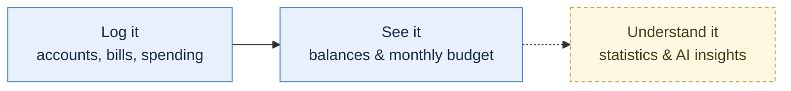

# Finance Tracker

**Money is easy to move and hard to understand.** Spreadsheets get out of
date, bank apps show one account at a time, and "where did it all go?"
never gets a real answer. This is a personal tool to change that: one
place to log what comes in and out, see actual balances across every
account, and know what needs to be set aside each month — with room to
grow into real insight, not just bookkeeping.



*Solid = available today. Dashed = planned.*

## Today

- **Track accounts** by purpose (e.g. Savings, Fixed Costs, Living) and
  always know the real balance of each — no manual recalculation.
- **Log recurring bills, income, and one-off costs** once; the app keeps
  track of what's due and what's been paid.
- **See the monthly set-aside** — what needs to move into which account to
  cover fixed costs plus a fair share of yearly/irregular bills.

## Roadmap

Not built yet, but where this is headed:

- **AI integration (via MCP)** — let an AI assistant read and manage your
  data directly, e.g. importing a messy spreadsheet of past spending.
- **Statistics & insight overviews** — spending trends over time, not just
  a snapshot of right now.

See [`docs/TODO.md`](docs/TODO.md) for the full, prioritized backlog.

## Stack

Nuxt 3 (TypeScript) frontend → Go (`net/http`, no framework) JSON API →
PostgreSQL. No ORM (`pgx` + `sqlc`), schema-first migrations
(`golang-migrate`). Details and rationale: [`docs/ARCHITECTURE.md`](docs/ARCHITECTURE.md),
[`docs/DECISIONS.md`](docs/DECISIONS.md).

## Quick start

```
docker compose up -d     # postgres + backend (:8081) + frontend (:3000)
```

For faster local iteration (native Go/Nuxt against a Compose Postgres) and
the full command reference, see [`CLAUDE.md`](CLAUDE.md).

## Docs

- [`docs/ARCHITECTURE.md`](docs/ARCHITECTURE.md) — domain model, backend/frontend layout, data flow
- [`docs/DECISIONS.md`](docs/DECISIONS.md) — why things are built the way they are
- [`docs/TODO.md`](docs/TODO.md) — backlog
- [`docs/INTELLIJ_SETUP.md`](docs/INTELLIJ_SETUP.md) — IDE run configs
- [`CLAUDE.md`](CLAUDE.md) — commands, ground rules, conventions
